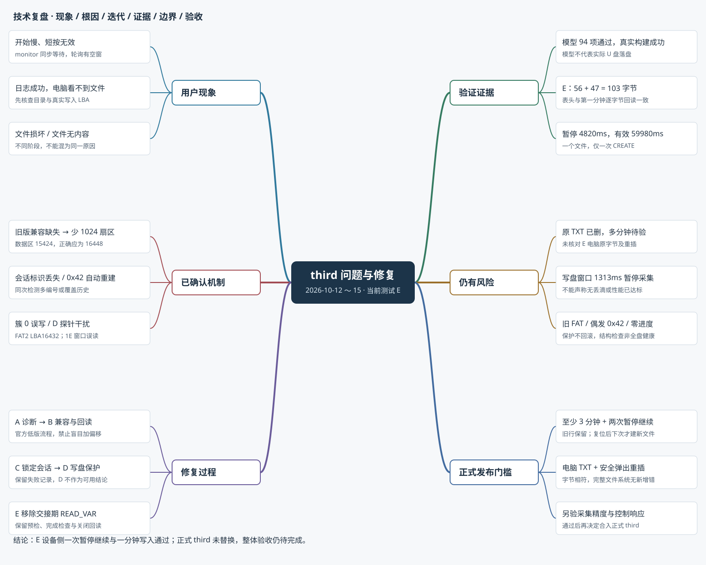

# third 固件问题分析与修复技术报告

**报告日期：2026-10-15｜证据范围：2026-10-12～15｜最新测试固件：20261015-E**

本报告面向 NIAIO 尿量检测设备的维护和后续开发，整理 third 从“开始响应慢、按键偶发无响应”到“U 盘无文件、文件损坏、文件无内容”的调查及修复过程。结论依据已保存的源码、串口日志、电脑只读磁盘证据、模型测试与构建记录。本次只编写报告，没有重新烧录、监听串口或读写 U 盘。

## 1. 结论与当前状态

**这次故障包含多个不同层面的问题，不能统一解释为 U 盘物理损坏，也不能仅凭“写入成功”日志认定保存成功。**

| 问题 | 已确认的原因或证据 | 修复与现状 |
|---|---|---|
| 首次开始约延迟 3～4 秒、实体短按有时无效 | 控制任务同步执行存储初始化和重试，按键轮询依赖同一任务 | 阻塞机制已通过代码和按键模型确认；独立存储任务等架构优化尚未实施 |
| 日志创建／写盘成功，电脑正常目录没有文件 | 旧版 CH376 兼容流程缺失，挂载的数据区基址稳定提前 1024 扇区；目录和文本实际落在 FAT2 内 | B 版完成有条件的旧芯片兼容处理；B 现场设备与电脑交叉验证过一次正确文件 |
| 一次检测出现多个编号，或同名文件历史内容可能被覆盖 | 初次建文件后验证失败未保留会话身份；恢复／追加遇到 0x42 自动 CREATE | C 版提前锁定会话编号，并禁止恢复和追加路径自动重建；C/E 日志支持保护生效 |
| 有文件但 Windows 提示损坏 | 非空文件首簇为 0，表头实际写入 FAT2 的绝对 LBA 16432 | D/E 增加 FAT 保留项、请求前上下文及完成字段检查；固件保护不负责自动修复旧盘损坏 |
| D 版有文件但没有正常内容 | 在 0x1E 数据交接窗口插入 READ_VAR 探针，读到临时 FILE/0001 内容，导致表头根本没有送入 | E 版删除交接期探针，恢复连续的数据供给握手 |
| 最新 E 版能否宣布全部修复 | 一次表头、暂停继续、第一分钟追加及设备回读通过；原 TXT 已被用户删除 | **设备侧一分钟通过，整体验收仍待完成；正式 third 尚未替换为 E** |

“已修复”在本报告中分为代码层修复、模型通过、设备侧验证、电脑持久化交叉验证四个层次。后者不能由前者自动推导。阶段报告为当时的结论，后续实测会收窄或修正它；例如 D 版模型通过后仍在实机暴露握手缺陷。[E01][E07][E08][E09]

## 2. 版本和证据边界

### 2.1 三类工程不可混用

| 名称 | 作用 | 本轮报告采用方式 |
|---|---|---|
| `second` | 用户确认曾经可用的分层参考工程 | 比较运行条件和写盘路径；没有在本次重新烧录验证 |
| `third` | 正式基线工程 | 101 个基线文件保持一致，不把测试修复覆盖到这里 |
| `third_logtest_20261012` | 独立诊断／修复工程 | 日志副本及 A、B、C、D、E 迭代；当前预编译镜像对应 E |

third 是工程目录，并非原有 Git 分支。A～E 是测试固件阶段标识，不是五个已经独立存在的 Git 分支。归档位于 `codex/ch376-test-records-20261015` 分支。报告引用的当前源码来自该归档的 E 测试工程。[E00]

历史上曾出现**同名日志被后一次导出覆盖**。例如 `串口日志_20261015_174855.log` 在两个阶段分别对应 C 与 D 内容，因此不能仅按文件名判断版本。需同时核对启动标识、字节数和 SHA256；已保存的阶段副本优先。[E08]

### 2.2 介质和硬件上下文

已检查现场盘为 General UDisk，整盘 4,026,531,840 字节；H: 分区起点 32,768 字节，即整盘 LBA 64，分区长 4,026,499,072 字节。盘符仅是当时的 Windows 映射，今后操作仍须重新核对物理介质身份。

目标 MCU 为 ESP32-S3，构建记录使用 ESP-IDF v5.5.5。CH376 实机版本为 `0x42`；参考与目标使用相同 CH376 GPIO：CS=2、SCK=42、MOSI=41、MISO=40、INT=1。串口日志按 115200、8N1、无流控、UTF-8 保存。本报告不包含新的原理图或示波器验收，不能把未验证的供电、SPI 电气问题写成已排除。[E02][E04][E08]

## 3. 问题与修复思维导图



导图分为六个分支：用户现象、已确认机制、修复阶段、验证证据、遗留风险、正式发布门槛。图中的“门槛”和“后续方案”表示尚待执行，不代表本轮新增了固件功能。

## 4. 代码层级与实际调用链

```text
手机命令 / 实体按键
  → monitor.c：唯一应用状态执行者（待开始 / 测量 / 暂停）
    → S1.c：检测会话、有效时间、分钟增量、写盘事务、5秒恢复
      → storage.c：编号、建文件、表头、恢复、追加、关闭与状态缓存
        → ch376_diag.c：BPB/FAT几何、旧版兼容、写前/完成检查、写后回读
        → ch376_spi.c：软件SPI、CH376命令、等待中断、字节写供数
          → CH376 文件系统引擎 → USB U盘 → FAT32目录/FAT/数据簇
```

串口屏与手机状态是展示通路，不能证明存储通路已经完成。手机本地记录和 U 盘记录按既定需求独立管理；串口工具导出的 CSV 也有自己的来源，不能当作 U 盘文件读取结果。

在 E 版中，应用状态仍由 monitor 顺序推进；递归互斥量用来串行化 SPI 访问，不会把同步存储流程自动变成异步。`S1_storage_start()` 仍在打开液滴采集之前执行。因此本轮存储修复并没有同时解决所有开始响应和按键扫描延迟。[E01][E10]

## 5. 开始延迟与按键无响应

### 5.1 阻塞发生在哪里

待开始收到 START 后的实际顺序为：

```text
S1_storage_start → storage_retry → 初始化/同步介质/建文件
返回后才 S1_reset → urine_capture_arm → S1_enter → 测量中
```

未插盘也会进入同步初始化路径，没有“先开始采集、存储异步准备”的快路径。测量中失败恢复同样在 monitor 内执行，失败后把下一次重试设置为本次结束时刻加 5000ms。**5 秒是重试间隔，不是固定的单次超时。** 若一次存储尝试占 3.5 秒，则可能形成阻塞约 3.5 秒、正常轮询约 5 秒、再阻塞的循环。[E01]

### 5.2 为什么会漏按键

原 key 驱动禁用 GPIO 按键中断，依赖轮询且要求连续 3 次相同电平才改变稳定态；按下回调同步进入应用执行。monitor 的“20ms 循环”实际是本轮工作耗时加延时，而不是保证每 20ms 必然扫描一次。

因此，整个按下与释放都处于存储等待窗口内时，短按会丢失；如果松手未被扫描，下一次按下也可能被认为一直按着。原 key.c 的主机模型复现了这两种路径。没有证据支持先把消抖次数改小或单纯提高优先级作为根因修复。[E01]

### 5.3 超时与本轮状态

历史 wait 循环明确忙等部分约 5 秒，实际取决于响应、GPIO 与调度开销，不能写成固定 3 秒。100Hz FreeRTOS 下 `pdMS_TO_TICKS(1)` 为 0，`vTaskDelay(0)` 不等于睡眠 1ms。手机命令还可能因执行前截止时间及快照陈旧而表现为不可操作。这些是既有调查结论，不是本次新测量。

E 现场开始准备文件约 1.86 秒、第一分钟写盘事务约 1313ms，仍表明同步路径与诊断成本存在。异步存储、独立按键扫描、单调时间超时和诊断日志精简都仍是后续事项。[E01][E09]

## 6. “写盘成功但没有文件”的定位过程

### 6.1 最初必须区分“日志停了”和“任务卡死”

second 与早期 third 的 15 个关键低层函数去掉注释和日志后逻辑一致；明显差异在文件生命周期、故障重试、日志屏蔽及外围任务。早期 third 在事务内同时屏蔽 CH376 和 storage 日志，成功时缺少单独的完成提示。用户后来确认手机和串口屏继续实时更新，因此单看最后一行“第 1 分钟写盘”不足以证明程序卡死。[E02]

2026-10-12 日志副本显示：建文件事务约 510ms，第一分钟事务约 269ms；表头 56 字节、分钟行 47 字节已完整提供，写／关命令均返回成功。问题已从“是否发送数据”收敛到“数据到底写在哪里”。这些耗时只属于对应版本和当次日志，不能代替 E 版耗时。[E03]

### 6.2 CSV 是理论记录，不是落盘证据

已检查串口工具：它从“进入临界区”日志解析 RecordRow，导出解析列表为 CSV。解析发生在写入结果之前，不读取 U 盘。因此 CSV 中有 `5.5ml / 330.0ml/h`，只能说明日志中出现这条待写记录，不能证明电脑可见 TXT 已保存。[E03]

### 6.3 FAT32 地址计算

本盘关键参数如下。下表地址统一使用**整盘绝对 LBA**，512 字节为一个扇区。

| 参数 | 数值 | 依据 |
|---|---:|---|
| 分区起点 P | 64 | MBR；32,768 / 512 |
| 保留区 R | 1056 = 0x0420 | BPB 两字节 `20 04`，小端 |
| FAT 份数 N | 2 | BPB |
| 每份 FAT 长度 F | 7664 扇区 | BPB |
| 每簇 S | 8 扇区 | BPB |
| 根簇 | 2 | BPB |
| FAT1 起点 | 1120 | P + R |
| FAT2 起点／终点 | 8784～16447 | P + R + F，长度 F |
| 正确数据区 D | 16448 | P + R + N×F |
| 旧芯片内部数据区 | 15424 | A 现场内部变量 0x50 |

```text
正确数据起点 = 64 + 1056 + 2 × 7664 = 16448
若只取保留区低字节 0x20：64 + 32 + 2 × 7664 = 15424
偏差 = 15424 − 16448 = −1024 扇区 = −524288 字节
簇 C 的正确首扇区 = 16448 + (C − 2) × 8
```

1056 本身是合法保留区值；不能为了适配芯片而先篡改 BPB。不能把分区内 LBA 16384 与整盘绝对 LBA 16448 混用。[E03][E04]

### 6.4 从算术假设到实物证据

10月12日电脑读到了位于错误 FAT2 区域的目录项和完整 103 字节文本：正常根目录没有 TXT，并非数据从未出现。此时“保留区高字节未参与芯片挂载基址”只是优先假设，尚不能指定芯片内部原因。

A 版补充了 CH376 物理只读 MBR/BPB、内部几何和文件定位日志。实物读取主／备份 BPB 均为 `20 04`，ESP32 的小端组合正确；0x50 在额外物理探针前已为 15424，复读、重挂载后仍一致。U0000003 首簇 8 的正确位置应为 16496，实际定位及电脑原始文本均为 15472，恰好提前 1024 扇区。该偏差在 Wi-Fi 初始化前就出现，不能把 Wi-Fi 竞争作为这条错误基址证据的充分解释。[E04]

### 6.5 B 版如何修复

参考保存的官方 EVT 低版本流程：芯片版本小于 0x43、文件系统未 READY 时，先空文件名打开根目录，再读取 8 位变量 0xCF，必要时以 `0xCF << 8` 调整芯片内部 0x4C 与 0x50，并清 0x70。实现增加 BPB、高字节、差值、内部基准和溢出约束；条件不吻合则拒绝写盘。已正确或 READY 时不叠加补偿。[E05]

B 现场实际得到 0xCF=04，修正量 1024；0x4C 从 64 变为 1088，0x50 修正为 16448。这里 **0x4C 是兼容后的厂商内部基准，不能继续强制等同 MBR 的 64**；更不能对所有物理读写地址统一加 1024。

B 实机的 U0000002 最终首簇 264、位置 18544，满足 `16448 + (264−2)×8`；电脑读取实际文件为 103 字节，与表头和一分钟 `9.5ml / 570.0ml/h` 一致。这个结果证明该次错位寻址已纠正，但同轮还有文件上下文和 FAT 异常，整体未通过。[E06]

## 7. 重复新建与历史覆盖风险：C 版修复

### 7.1 正常业务语义

| 操作 | 文件预期 |
|---|---|
| 待开始 → 开始 | 建立本次新检测的文件 |
| 测量中重复 START | 幂等，不新建 |
| 暂停 → 继续 | 沿用同一会话、同一文件，暂停时间不累计 |
| 检测复位 → 下次开始 | 新检测，应分配新文件 |

正常暂停继续代码原本就不调用新建入口。真正的缺陷是异常恢复可能在继续之后执行，使表象看起来像“按继续就建文件”。不能把复位后的新文件与同次检测的重复建文件混为一谈。[E10]

### 7.2 两条已确认的缺陷路径

**路径一：创建发生了，会话身份却没返回。** 旧逻辑只在创建、表头、关闭和校验全部成功后把候选编号交给 S1。若真实文件已建立但回读失败，上层标识仍为空；5 秒后的重试再次选号，造成同一次检测出现多个编号。B 日志中 U1 回读失败后重新分配 U2，发生在第一次暂停之前。

**路径二：恢复／追加遇到 0x42 就现场创建。** B 日志中已知 U2 打开返回 0x42 后，执行 FILE_CREATE，首簇由 8 变为 264。FILE_CREATE 具有同名覆盖语义；即使文件名没变，也不能证明历史行保留。0x42 是该次芯片访问结果，不能在已知会话上下文中直接当作安全重建授权。[E06][E10]

### 7.3 C 版更改及取舍

编号在第一次 CREATE 之前写入会话缓冲，同时推进下一编号。创建回复、表头、关闭或回读失败均保留该身份；之后只恢复同一文件。恢复和追加遇到 0x42 明确报错，禁止再次 CREATE 或写表头；短文件和损坏表头也不自动修补覆盖。[E07]

代价是：文件确实缺失或首次创建结果不确定且表头不完整时，会继续计量并提示未保存，而不会冒险重建。缺失分钟不补写，未引入离线缓存，也未实现跨硬件重启会话恢复。首次新检测的候选判空仍依赖 OPEN 结果，若底层误报历史文件不存在，初次创建的绝对防覆盖保证仍不成立。

会话联合回归对旧代码 14 项中失败 10 项，C 后 14 项通过。C 现场只锁定 U3，34 次失败恢复均未换号或重建，说明会话保护生效；同时首次表头已出现簇 0 错写，说明会话修复不能替代底层保护。[E07][E11]

## 8. 文件损坏与非法首簇：D 版保护

### 8.1 损坏不是资源管理器未刷新

C 现场普通目录显示 U0000003.TXT 长 56 字节，原始目录项首簇为 0；Windows 原生 ReadFile 返回 1392。非空文件使用 FAT 保留簇号 0 不合法。日志显示首簇／当前簇均为 0，读写 LBA=16432；电脑原始读取该扇区前 56 字节确实是本次 UTF-8 表头。[E11]

```text
非法目标 = 16448 + (0 − 2) × 8 = 16432
16432 位于 FAT2 范围 8784～16447 内
```

该次两份 FAT 的新增差异索引 7648 对应绝对 LBA 16432，形成日志、目录项、公式与真实扇区的相互印证。FAT[0] 此时为 0x0FFFFFFF，而 BPB 介质 F8 要求低 28 位为 0x0FFFFFF8；前一轮它已经异常为 0。两轮间还有其他操作，所以不能把 FAT[0] 每次变化唯一归因于一条代码，更不能仅凭此认定闪存物理坏。[E11]

### 8.2 D 增加的防线

1. 创建／恢复前读取各份 FAT 首扇区，核对保留项 0/1 与首扇区副本一致性；BPB 缓存有效也重新检查 FAT。
2. 请求前校验数据区、目录 LBA、文件上下文和范围；空文件、整簇 EOF 尚待分配的状态不能被误判为已损坏。
3. 写完 0x14 后检查持久首簇、长度和指针；完成后的临时缓冲可能切回 FAT，不能强制它仍是数据页。
4. 写入故障锁存；FILE_CLOSE 发送参数 0，不把新的长度更新进异常目录项。
5. 关闭后重新挂载、重新打开，核对准确总长和新增段内容。[E12]

这些措施不写物理修复扇区、不格式化、不恢复旧文件。FAT 首扇区检查也不等于完整 FAT 表或所有簇链检查；事后验证不具备回滚已经发生写入的能力。

## 9. D 版空内容：诊断探针本身造成干扰

### 9.1 现场把问题定位到表头供数之前

D 实测同名日志新副本为 274653 字节，SHA256 `60E4A345026A8AED3C5004864B2083AE5FF15BA97DE4D6E82E9D959F0725EB58`。电脑 U1 文件仅 1 字节 `2E`（句点），没有正常表头。这个 1 字节的形成来源无法仅凭现有日志确定，不应擅自补出解释。[E08]

14394ms，BYTE_WRITE 返回 0x1E。D 新增的 CanFeed 在这一交接窗口读取 0x60/0x64 等内部变量，读到 `46 49 4C 45`（FILE）和 `30 30 30 31`（0001），无法作为稳定的簇号。保护中止，**该次没有发 WR_REQ_DATA，也没有发 WR_GO，56 字节表头未被提供**。所以“再等一分钟”或调整文本编码无法解决这一轮空内容。[E08]

### 9.2 为什么模型没提前发现

D 的旧模型把内部变量当作静态寄存器，并以简化的布尔 CanFeed 桩代替真实诊断实现，没有覆盖 0x1E 交接期窗口映射临时内容的行为。于是“保护模型全过”只证明了模型假设内的逻辑，并未证明探针插入点安全。这是测试覆盖缺口，不能把 D 的通过数当作真实硬件可用性的保证。

### 9.3 E 版修复原则

```text
请求前：FAT/几何/文件状态检查
  → BYTE_WRITE 0x3C，发送长度
  → 状态 0x1E：仅说明芯片请求本批数据
  → WR_REQ_DATA 0x2D，读取块长并供数
  → BYTE_WR_GO 0x3D
  → 若仍 0x1E，继续供下一批
  → 最终 0x14 且数据供完：检查持久字段
  → FILE_CLOSE → 重挂载 → OPEN → 精确长度/逐字节回读
```

E 删除 CanFeed API 和写循环中的调用，不在 0x1E→供数→继续写入之间插入 READ_VAR 或其他诊断 SPI 命令。保留请求前检查、完成检查、异常关闭及回读。C 的会话规则和 Wi-Fi 相关文件未因这轮修复改变。[E08]

新增有状态模型联合真实 diag.c 与 BYTE_WRITE_DATA，模拟 FILE 窗口：D 对四项测试有三项失败，E 四项全部通过，56 字节完整表头供数一致。该模型验证代码和供数轨迹，仍不等于 U 盘物理落盘。[E08]

## 10. 写盘事务、Wi-Fi 和液滴采集

按用户确认，10月12日已把新建／恢复／分钟写盘放入统一事务：递归互斥串行化 SPI，暂时暂停液滴 GPIO 中断、串口屏推送和手机新状态推送，退出恢复原状态与日志等级。**这不是全局关闭 CPU 中断或 FreeRTOS 调度，也没有主动关闭 Wi-Fi AP。**[E13]

手机握手、控制 ACK 和 TCP 连接保留；已经排队的帧、网络底层也可能继续。“暂停推送”不是无线静默，更不是断开 Wi-Fi。测量已暂停或待开始时，事务退出不会错误重新开启采集。

15 项控制与保护模型覆盖嵌套、失败出口、采集原状态恢复和手机推送竞争。它们不能证明真实网络永不断联，也不能证明关闭液滴中断期间不丢滴。E 现场 1313ms 的事务含诊断／回读，窗口内液滴可能未被计入；性能和计量连续性必须单独验收。该事务对齐是运行条件调整，不是已证实的 1024 扇区错位根因修复。

## 11. 修复与实测时间线

| 日期／阶段 | 本阶段主要动作 | 验证结果和后续发现 |
|---|---|---|
| 10-12 控制调查 | 定位 monitor 内同步存储与轮询按键的耦合 | 代码／按键模型确认，未实施异步架构 |
| 10-12 second 对比 | 对比 15 个核心函数与运行环境 | 核心逻辑一致，不能凭 second 可用就认定 third 一定是 Wi-Fi 干扰 |
| 10-12 事务保护 | 暂停采集／屏幕／手机新状态，保留连接 | 15 项模型通过，后续错位写盘仍存在 |
| 10-12 日志副本 | 独立备份、打印供数与阶段耗时 | 无卡死证据，真实目录和文本在 FAT2；CSV 只是日志解析 |
| 10-14 介质恢复 | 分区完整镜像、授权 CHKDSK、恢复可识别文本 | 当时 Windows 检查无错；并未修复设备端错误基址 |
| 10-14 A | MBR/BPB、内部变量、文件 LBA 对照 | 错误数据基址 15424；主／备份 BPB 与电脑正确值为 16448 |
| 10-14 B | 官方旧版兼容＋门控＋关闭重挂载回读 | 一次电脑文件 103 字节相符；仍有首簇读回不一致、0x42 后重建和 FAT 异常 |
| 10-15 C | 先锁定会话身份，恢复／追加禁止 CREATE | 会话 14 项通过；现场不换号，但 U3 首簇 0、表头误写 FAT2 |
| 10-15 D | FAT 预检、分阶段写盘保护、异常关闭 | 94 项模型通过；实机 0x1E 插探针误拦，表头未供数 |
| 10-15 E | 删除交接期探针，新增有状态联合握手模型 | 94 项模型通过、ESP32-S3 构建成功；最新一次设备侧一分钟验证通过 |

A 和早期日志副本主要用于诊断；B～E 包含功能性修复或保护，不能统称“只加打印”。D 失败过程应保留，不可只展示最终成功日志。

## 12. 最新 E 版验收数据

### 12.1 软件回归和构建

| 套件 | 通过项数 | 证明范围 |
|---|---:|---|
| 地址／兼容／回读 | 41 | BPB、范围、兼容及回读模型 |
| 字节写／等待 | 12 | 实际函数与返回状态场景 |
| 控制／写盘保护 | 15 | 事务嵌套、恢复、采集／推送状态 |
| 检测会话联合 | 14 | 实际 monitor/S1/storage 的会话生命周期 |
| 存储服务 | 8 | 创建、恢复、追加及验证契约 |
| 有状态交接 | 4 | 实际诊断与写循环联合，覆盖 D 现场缺口 |
| **合计** | **94** | **模型通过，不替代硬件／持久化／计量验收** |

E 应用 `third.bin` 为 847536 字节，SHA256：

```text
CF933491B7A1D11C145EB29A2B2FABA391C628E41E07DEF36D863ECC924A6129
```

对应工程已保存匹配的 bootloader、分区表及应用；应使用该工程的烧录参数，不混用旧 third 镜像。实际下载端口须核对，不能因为 COM21 曾是日志口就直接当作 ESP32 下载口。[E08]

### 12.2 192927 实机日志核对

日志 138944 字节，SHA256：

```text
83594BDD4B5FB78731CF3757A58BD2601356F02FDEFB668AC1A6F1B3AA0D3510
```

| 项目 | 日志结果 | 判定 |
|---|---|---|
| 版本 | 20261015-E | 与 E 匹配 |
| 文件生命周期 | 仅 1 次 CREATE，始终 U0000001.TXT | 本次未换号／同名重建 |
| 表头 | 发送 56 字节；关闭重挂载后准确 56，逐字节一致 | 设备侧通过 |
| 第一分钟 | `00:01:00  7.0ml  420.0ml/h` | 7.0×60=420.0 |
| 滴数与体积 | 屏幕 14 滴，按 0.5ml/滴为 7.0ml | 本次算术一致，不等于实际体积校准 |
| 追加 | 从偏移 56 加 47 字节，总长 103 | 设备重开回读新增段一致 |
| 首簇及位置 | 首簇 6，数据 LBA 16480 | 16448+(6−2)×8，位于数据区 |
| 暂停继续 | 24204→29024ms，暂停 4820ms | 同一文件，继续不建新文件 |
| 一分钟计时 | 开始 8674ms，触发 73474ms | 73474−8674−4820=59980ms，符合20ms粒度 |
| 错误 | 无 E 级错误、无本次分钟跳过 | 仅限本日志窗口 |
| 网络 | AP/DHCP 启动，192.168.4.1 | 证明启动，未做覆盖距离或长稳测试 |

13 项日志条件全部满足。日志只到约 1 分 08 秒，用户已删除原 TXT，**E 本次没有电脑文件原字节核对、重插持久性、多分钟历史行及完整 FAT 验收**。B 以前的电脑 103 字节验证不能代替 E 的最终验收。[E09]

## 13. 遗留风险和后续改进

| 优先级 | 遗留事项 | 下一步证据／处理 |
|---|---|---|
| 发布前必验 | E 多分钟、电脑原文件、重插及文件系统一致性 | 按下一节完整复测，不以模型或设备回读替代 |
| 发布前必验 | 写盘暂停液滴中断可能漏计 | 用稳定脉冲源／已知滴数对照写盘窗口，再决定采集与存储解耦 |
| 高 | monitor 同步存储使控制／按键扫描延迟 | 独立单属主存储任务、按键只投事件、命令完成时间戳；目前未实施 |
| 高 | 已有文件 OPEN 偶发 0x42、首簇曾 7→263 | 保留原始错误，不通过自动重建掩盖；故障注入与实机连续访问验证 |
| 高 | 旧盘可能仍有历史 FAT 损坏 | 先保留原始证据和备份，再单独恢复；首扇区预检不能宣称全表健康 |
| 中 | 单次异常块长／零进度 | 当前写循环遇零或超量请求有告警，未整体改写原供数算法；若持续0x1E且零进度，仍须专门做有界退出复核，E现场未出现此模式 |
| 中 | 未保存分钟无补写、末尾不足一分钟不单独落盘 | 当前分钟编号和增量基准已消费；如需补写或尾段记录，应另定协议与缓存需求 |
| 中 | 新会话查重依赖芯片 OPEN | 底层误报历史文件缺失时仍有首次创建冲突边界，不能承诺绝对防覆盖 |
| 中 | 诊断体积／耗时 | 用精简后的单独版本重新评估，不能仅关闭日志就宣称性能问题解决 |

物理 Flash 16MB 与镜像声明 2MB 的提示已出现；当前镜像在声明分区内，现有日志没有显示它导致写盘故障，不应无依据改分区。部分历史源码注释滞后，例如初始化旧注释仍写挂载失败可继续，但当前实际分支已经返回失败；维护判断以执行代码和测试为准，不把旧注释当行为保证。

后续建议按三步推进：先完成 E 的存储闭环验收，再以单独变更处理控制与采集解耦，最后裁剪诊断并重新做性能回归。本报告没有实施这些架构变更。

## 14. 下一轮最小闭环验收方案

### 14.1 准备与执行

1. 保留当前原始日志和 U 盘文件；确认烧录的是 E 及匹配镜像，记录 SHA256。不要先删除输出文件。
2. 上电保存完整日志：版本 0x42、MBR/BPB、FAT 预检、兼容前后基址。数据区差值应为 0；任何预检拒写均先留证，不通过反复开始或格式化掩盖。
3. 开始一条新检测，有效测量至少 3 分钟，中间暂停继续两次；记录每次动作时间、文件名、CREATE 次数、逐分钟新增长度和回读结果。
4. 检测复位并等待相关事务完成，再开始第二条检测。第一条应保持原名和历史行，第二条获得不同编号；暂停继续不应创建第三条文件。
5. 使用业务复位、等待写盘和回读全部结束后转接电脑。保存两个原始 TXT、目录列表及完整串口日志，再安全弹出和重新插入核对；必要的文件系统检查先只读留证。

### 14.2 通过标准

| 检查对象 | 通过要求 |
|---|---|
| 会话 | 第一条仅首次开始 CREATE；暂停继续同标识；复位后才出现第二会话 |
| 每分钟追加 | 偏移等于上一轮准确总长；旧行仍在；新增内容与当分钟日志一致 |
| 字节长度 | 若表头56、每行47，则三分钟应为197；实际按 `56 + Σ每行真实字节数` 计算，不能固定所有行永远47 |
| 电脑内容 | UTF-8 表头及三条历史行可正常读取，无1392；原字节与请求内容对应 |
| 持久性 | 安全弹出／重插后文件名、内容、长度不变 |
| 文件系统 | 无新增FAT差异、丢失簇或非法目录项；区分旧损坏与本次新增 |
| 采集和控制 | 另测写盘窗口滴数、首次开始和短按响应；存储正确不等于这些已合格 |

现有文件是三列文本（检测有效时长、分钟尿量、分钟平均流速），不是完整的绝对年月日时间序列，也不是 APP 全部分钟详情字段的导出。不要把手机界面的需求直接当作 U 盘现有格式。

仅当以上对应项有真实结果，才考虑把测试修复合入正式 third。

## 15. 固件发布与回退记录

当前正式 third 保持 101 文件基线；测试 E 的应用哈希见第12节。C 应用哈希为 `136845574616991B93599046CBE1B85FF0A13B65E856EA520ABA9262D91B75E1`；D 为 `9EC4672D25A6C7DD8EF467EAFB88B3E0EBA40789BB8DDBF49C8BBCD2F09878AF`。这些旧镜像用于追溯，不推荐把失败阶段重新作为正常测量版本。[E07][E12]

回退应同时选择对应源码、bootloader、分区表、应用及 flash_args，按清单核对。固件回退不回滚 U 盘 FAT 或历史文件，不能把旧固件烧回去当作介质修复。实际再次烧录、修盘和正式发布不属于本报告操作。

U 盘授权恢复前保存了完整分区镜像，大小 4,026,499,072 字节，SHA256 `2B04438A9499DFC53FF8EC3AA52EB6FB61EC2887EC526218C5502B912C81F419`。它包含分区，不包含 MBR；MBR 参数另有记录。10月14日修复后当时两份 FAT 一致、只读 CHKDSK 无错，恢复 6 个可识别文本；这不证明后续设备测试没有再次损坏，也不证明全盘闪存物理健康。[E14]

该约4GB镜像保留本机 `F:\ESP32\niaio\outputs\usb-repair-20261014\General-UDisk-H-partition-before-repair.img`，未纳入普通 Git 上传；仓库保存哈希、关键扇区及恢复报告。

## 16. 证据索引与复核入口

以下链接对应已归档材料。历史报告中的“未实机”指该报告生成时的阶段状态；最新结论应结合 E09 阅读。历史脚本可能依赖原目录布局，不能把介质修复脚本当普通回归直接运行。本次没有重跑固件模型，引用的是已保存验证记录。

- **E00**：[测试归档总索引](../CH376-20261012-15.md)、[1181份材料清单](../../../test-records/ch376/2026-10-12_15/ARCHIVE_MANIFEST.json)。
- **E01**：[开始延迟与按键调查](evidence/control-latency-diagnosis-20261012.md)。
- **E02**：[second 与 third 对比](../../../test-records/ch376/2026-10-12_15/outputs/ch376-disk-audit-20261012/second-third-comparison.md)。
- **E03**：[10月12日21:28日志与介质对照](../../../test-records/ch376/2026-10-12_15/outputs/ch376-disk-audit-20261012/after-logtest-212834/report.md)。
- **E04**：[A版错误地址实物证据](../../../test-records/ch376/2026-10-12_15/outputs/ch376-disk-audit-20261014/after-address-A-104412/report.md)。
- **E05**：[B兼容处理说明](../../../test-records/ch376/2026-10-12_15/outputs/third-compat-validation-20261014/README.md)。
- **E06**：[B部分通过、整体未过验收](../../../test-records/ch376/2026-10-12_15/outputs/third-acceptance-20261014/report.md)。
- **E07**：[C会话修复记录](../../../test-records/ch376/2026-10-12_15/outputs/third-session-fix-20261015/report.md)。
- **E08**：[E握手修复报告](../../../test-records/ch376/2026-10-12_15/outputs/third-handshake-fix-20261015/report.md)、[94项模型与构建记录](../../../test-records/ch376/2026-10-12_15/outputs/third-handshake-fix-20261015/verification.json)。
- **E09**：[最新E一分钟日志验收](../../../test-records/ch376/2026-10-12_15/outputs/third-e-log-acceptance-20261015/report.md)、[机器核对结果](../../../test-records/ch376/2026-10-12_15/outputs/third-e-log-acceptance-20261015/result.json)。
- **E10**：[重复文件代码路径分析](../../../test-records/ch376/2026-10-12_15/outputs/start-file-analysis-20261015/report.md)。
- **E11**：[C文件损坏与FAT2误写调查](../../../test-records/ch376/2026-10-12_15/outputs/third-corruption-20261015/report.md)。
- **E12**：[D保护候选及边界](../../../test-records/ch376/2026-10-12_15/outputs/third-cluster-fix-20261015/report.md)。
- **E13**：[事务保护记录](../../../test-records/ch376/2026-10-12_15/outputs/storage-write-guard-20261012/README.md)。
- **E14**：[U盘备份及授权修复报告](../../../test-records/ch376/2026-10-12_15/outputs/usb-repair-20261014/repair-report.md)。

当前 E 源码定位：

| 文件与入口 | 核对事项 |
|---|---|
| [monitor.c](../../../third_logtest_20261012/main/app/monitor/monitor.c)，约195/224行 | 命令执行、开始先准备文件、暂停继续和复位语义 |
| [S1.c](../../../third_logtest_20261012/main/app/S1/S1.c)，75/193/268行 | 事务保护、分钟增量、写盘结果和5秒恢复 |
| [storage.c](../../../third_logtest_20261012/main/service/storage/storage.c)，213/275/309行 | 创建前锁定编号、恢复与追加禁止CREATE |
| [ch376_diag.c](../../../third_logtest_20261012/main/driver/ch376/ch376_diag.c)，139/263/316/343/383行 | FAT预检、兼容、请求前／完成检查、重挂载回读 |
| [ch376_spi.c](../../../third_logtest_20261012/main/driver/ch376/ch376_spi.c)，617/674行 | 无CanFeed的供数握手、异常关闭参数 |

厂商参考的本地证据保存于 [A版诊断归档](../../../test-records/ch376/2026-10-12_15/outputs/third-address-log-20261014/)，包括手册提取与 EVT 文件；上游入口：[CH376手册（二）](https://www.wch-ic.com/downloads/CH376DS2_PDF.html)、[FILE_SYS.C镜像](https://github.com/changleo828/BOSSEN_USB_FOR_WT/blob/master/Documents/EVT/EXAM/FILE_SYS.C)。兼容处理依据归档时保存的厂商手册与 EVT 副本，保留来源以供复核。
