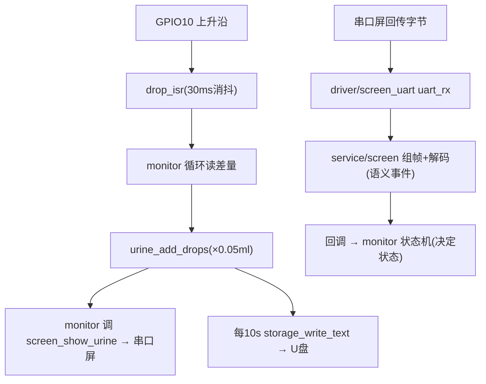

# 尿量计固件 — 工程总览（分层 v4）

> ESP32-S3 尿量监测设备固件。业务代码位于本 `main/`。

## 1. 设备在做什么

- 用滴传感器数“尿滴”（GPIO 上升沿）
- 按 **每滴 0.05 ml**（`URINE_DROP_ML_DEFAULT`，需标定）换算累计尿量
- 通过**串口屏（淘晶驰 TJC/Nextion，UART）**显示
- 用 **CH376 + U盘** 周期把记录以文本落盘

## 2. 分层结构（v4）

| 层 | 目录 | 角色 | 说明 |
|---|---|---|---|
| app | `app/` | **主状态机/监控中枢**（唯一主动循环） | `app/README.md` |
| service | `service/` | **app↔driver 桥接服务**：`urine`(计算)、`screen`(串口屏)、`storage`(U盘) | `service/README.md` |
| driver | `driver/` | 底层硬件：`ch376 drop key screen_uart battery time_svc` | `driver/README.md` |
| bsp | `bsp/` | 板级：`pin_map.h`(引脚)、`err.h`(通用错误码) | `bsp/README.md` |
| 入口 | `main.c` | 初始化与编排 | 本文档 §4 |

依赖方向（禁止反向）：`main.c → app → service → driver → bsp`

> 物理按键（`driver/key`）接口暂留在驱动层，业务（monitor）**当前只由串口屏回传事件驱动**，按键未接入。

## 3. 任务划分（FreeRTOS）

| 任务 | 栈 | 优先级 | 职责 |
|---|---|---|---|
| `monitor` | 4096 | 5 | 主状态机：读滴/累计、推显示、接收串口屏回传决定状态、10s 写U盘 |
| `uart_rx` | 2048 | 6 | driver/screen_uart 自建：收串口屏字节 → 回调 service/screen 解码 |

> `service/*` 均为被动服务（不建任务）。

## 4. 入口 `main.c` 启动序列

```c
void app_main(void) {
    timesvc_init();      // driver: 时间(底层取时)
    drop_init();         // driver: 液滴中断
    screen_uart_init();  // driver: 串口屏 UART
    battery_init();      // driver: 电池(占位)
    if (storage_init() != ERR_OK)  // service: U盘(失败仅告警继续)
        ESP_LOGW(...);
    screen_init();       // service: 串口屏服务(注册接收+初始界面)
    app_monitor_start(); // app: 主状态机
    for(;;) vTaskDelay(1000);
}
```

## 5. 核心数据流



## 6. 现状与已知缺口

- **可用**：滴计数 → 尿量换算 → 串口屏显示；U盘检测与周期写盘；串口屏回传“解码→回调 monitor”链路已搭（真实协议待接）。
- **缺口**：
  1. U盘为“创建(覆盖)后写”，**无法累积历史日志**（`storage.c` 内 TODO）
  2. 时间戳为开机计时 `T+Ns`，无真实 RTC
  3. `battery` 为占位 stub（`display` 已删除）
  4. 串口屏回传的**协议映射未定义**（`screen.c` 的 `handle_rx_frame` 仅打日志）
  5. 物理按键未接入业务（接口留 driver）
  6. 每滴 0.05ml 需标定

## 7. 构建注意

- 移动项目导致 build 缓存失效时删除 `build/` 重建。
- `-Werror`：ESP32 上 `uint32_t` 实为 `unsigned long`，打印用 `%lu` 并强转。
- IntelliSense 依赖 `build/compile_commands.json`（`.vscode/c_cpp_properties.json` 已配）。
