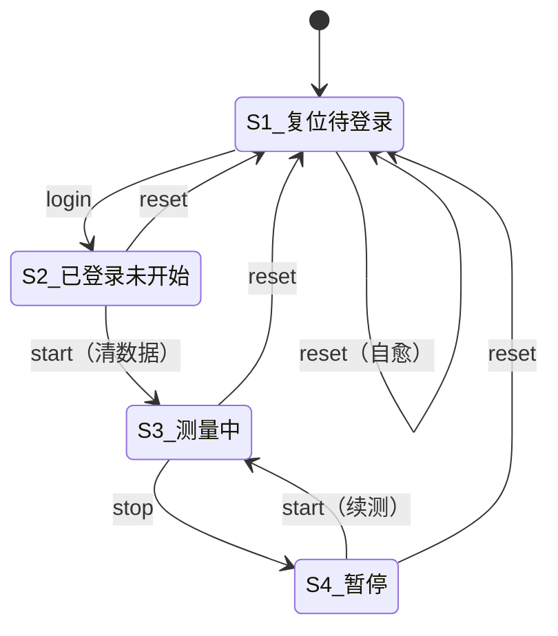
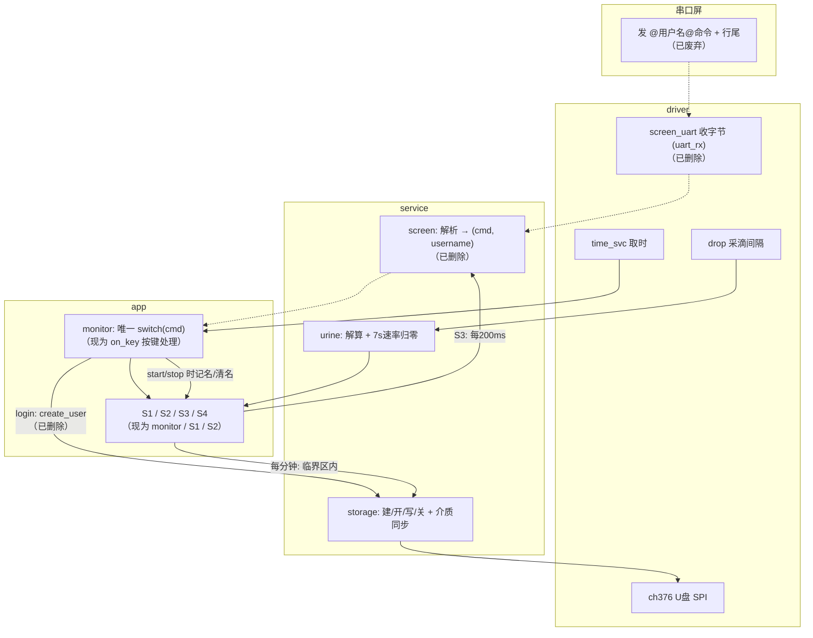

# 测量状态机与指令协议 —— 技术文档

> ## ⚠️ 已废弃：本文描述的是旧的串口屏命令协议，仅作历史参考
>
> **当前协议见《[单片机与串口屏通信格式.md](单片机与串口屏通信格式.md)》，当前状态机见 [`main/README.md`](main/README.md) 与 [`main/app/README.md`](main/app/README.md)。**
>
> 本文描述的是 `second` 版本里"屏端发 `@用户名@命令`、MCU 双向收发"的那套协议，在 `second sol` 两键版中已整体废弃：
>
> | 本文（旧） | 现状（两键版） |
> |---|---|
> | 屏 → MCU 接收链路（`@用户名@login/start/stop/reset`、接收回调、接收任务、同步读接口） | **整条链路已删除**：固件只发不收（`driver/screen_uart` 分配了 256 字节 RX 缓冲，但固件从不读取、也无接收任务） |
> | 旧四态 S1~S4（`LOGIN` / `READY` / `PAUSE` 文本） | **已被三态状态机取代**：待开始 / 测量中 / 暂停 |
> | 旧目录 `app/S3`、`app/S4` | **已删除**，功能拆入 `app/monitor`（报警栏/1 秒节拍）与 `app/S1`（测量期处理） |
> | 命令驱动（`on_cmd()` 里的 `switch`） | 改为**按键驱动**：`monitor` 的 `on_key()` —— K1 开始/暂停/继续，K2 任何状态复位 |
> | 屏上 5 个控件 | **8 个控件**：`data.t0` 尿量、`data.t1` 速率、`data.t2` 滴数、`data.t3` 计时、`data.t4` 状态栏（**命令字 `reset` / `start` / `stop`**）、`data.t6` 时钟、`data.t7` 电量；报警栏 `data.t5`（**单字母** `A`~`E`，每秒发一次）的 id 仍为**占位**（HMI 尚未制作） |
> | 按用户名建 `<用户名>.TXT` | 按测量编号建 `/U0000001.TXT`（大写 8.3），不再涉及用户名 |
>
> 下文保留原文，只在会误导处插入 `【现状】` 标注。**协议细节、行尾实测结论、CH376 8.3/LFN/介质同步等踩坑记录仍然有效**，这正是本文的历史价值。

> 工程：`F:\ESP32\niaio\git\second`（分层版）
> 平台：ESP32-S3 / ESP-IDF v5.5.5
> 主题：串口屏（淘晶驰 TJC）通过文本指令驱动"登录-测量-暂停-复位"状态机

---

## 1. 指令协议（串口屏 → 单片机）—— **已废弃**

```
@用户名@login    登录
@用户名@start    开始测量 / 继续测量
@用户名@stop     暂停测量
@用户名@reset    复位
```

`【现状】` 固件不再解析屏发来的任何字节。与旧命令等价的动作改由实体按键触发，状态由**状态栏控件**以命令字表达（`reset` / `start` / `stop`）—— `@start` 一类事件指令已取消（见《单片机与串口屏通信格式.md》§4）。

### 1.1 行尾（**现场实测很重要**）

| 写法 | 是否支持 |
|---|---|
| `\r\n`（`0D 0A`） | ✅ 标准 |
| `\n`（`0A`） | ✅ |
| **字面量 `/n`（`2F 6E`）** | ✅ **兼容** |

> ⚠️ 现场屏端发的**不是** `0D 0A`，而是**字符 `/` 和 `n`**（`2F 6E`）——
> HMI 里把 `\r\n` 当转义写了，TJC 不认这种转义，会原样发出去。
> MCU 端三种都认，但**屏端建议改对**：
> ```
> prints "@abc@login",0
> printh 0D 0A
> ```

`【现状】` 这条实测结论**已不适用**：`@` 事件指令已取消，现在发往屏的指令只有一种 —— 文本控件 `<控件名>.txt="内容"` + `FF FF FF`，没有任何 `\r\n` 结尾的指令。

### 1.2 用户名规则

- 夹在**两个 `@` 之间**，取第 1 个 `@` 与第 2 个 `@` 之间的**全部字符**
- **可以含空格**（含首尾空格），**不含 `@`** → 用两个 `@` 定界唯一
- 原样保留、**不做 trim**
- 最长 **31** 字符（`SCREEN_USERNAME_MAX`）

`【现状】` 用户名概念已从通信层移除，本节仅作字符串解析的历史参考。

### 1.3 用户名校验规则

| 命令 | 是否校验用户名 |
|---|---|
| `login` | ❌ 不校验（它就是用来换用户的） |
| `reset` | ❌ 不校验（**不管当前登录的是谁，收到就复位**） |
| `start` | ✅ 必须与当前登录用户名一致 |
| `stop` | ✅ 必须与当前登录用户名一致 |

### 1.4 行首杂字节

屏在**上电/复位时**会回传一帧 `1A FF FF FF`（既不是行尾也不是 `/n`）。
若不处理，它会赖在行缓冲里把**第一帧命令**顶成"非 `@` 开头"而整帧丢弃。

**两道防护**（旧 `service/screen`）：
1. 行缓冲为空时只接受 `@`，其它字节直接丢
2. 解析时从行内**第一个 `@`** 开始（并打 WARN 提示跳过了几个字节）

`【现状】` 固件不收屏数据，这一帧由硬件/驱动直接丢弃，该问题不再存在。

---

## 2. 指令对应表 —— **已废弃**

| 完整指令 | 指令 | 含义 | 状态变化（旧编号） |
|---|---|---|---|
| `@用户@login` | login | 登录（建文件） | S1 → S2 |
| `@用户@start` | start | 开始测量 | S2 → S3 |
| `@用户@start` | start | 继续测量 | S4 → S3 |
| `@用户@stop` | stop | 暂停 | S3 → S4 |
| `@用户@reset` | reset | 复位 | **任意状态 → S1** |

`【现状】` 现在只有按键路径，屏只**收**指令、不**发**指令；按键本身也不发屏指令，状态栏文本由 `ui_sync()` 在下一个 20 ms 循环按变化补发：

| 动作 | 按键 | 屏上的变化（状态栏命令字） | 状态变化（新） |
|---|---|---|---|
| 开始 | K1（待开始） | `data.t4.txt="start"` | 待开始 → 测量中 |
| 暂停 | K1（测量中） | `data.t4.txt="stop"` | 测量中 → 暂停 |
| 继续 | K1（暂停） | `data.t4.txt="start"` | 暂停 → 测量中 |
| 复位 | K2（**任何状态，含待开始**） | `data.t4.txt="reset"` | 任意 → 待开始 |

---

## 3. 四个状态 —— **旧编号，已废弃**

| 旧状态 | 旧名称 | 含义 | 旧屏上文本 | `【现状】` 对应 |
|---|---|---|---|---|
| S1 | 复位待登录 | 上电/复位后；未登录 | `LOGIN` | 已取消（无登录概念） |
| S2 | 已登录未开始 | 已登录、文件已创建；未测量 | `READY` | **待开始**（`APP_IDLE`，文本 `待开始`） |
| S3 | 测量中 | 采滴、解算数值、上屏、每分钟写 U 盘 | （强弱见 §5） | **测量中**（`APP_MEASURING`，实现落在 `app/S1`） |
| S4 | 暂停 | 停止计时；数据保留 | `PAUSE` | **暂停**（`APP_PAUSED`，实现落在 `app/S2`） |

> 旧屏上文本 `LOGIN/READY/PAUSE` 已被中文三态 `待开始/测量中/暂停` 取代；
> 报警另占一个控件（`data.t5`，**单字母**：`A` 正常 / `B` 无尿 / `C` 少尿 / `D` 多尿 / `E` 尿袋满；每秒发一次，`E` 只在首次满 2 L 时插播 1 分钟；该 id 目前是**占位**）。

---

## 4. 状态转移图（旧命令驱动，**仅历史**）



> **`reset` 在 S2/S3/S4 都能触发**（早期版本只允许 S4，已放宽）。
> `start` 在 S1/S3 忽略并告警；`stop` 只在 S3 有效；`login` 只在 S1 有效。

`【现状】` 转移改由按键驱动，等价关系：旧 `login` + `start` 合成 **K1（待开始→测量中）**；旧 `stop` = K1（测量中→暂停）；旧 `start`（续测）= K1（暂停→测量中）；旧 `reset` = **K2（任何状态，且待开始时也执行并把状态栏刷成 `reset`）**。

---

## 5. 关键变量随事件的变化（**旧实现，仅历史**）

| 变量 | login(→S2) | start(→S3) | stop(→S4) | 暂停后 start(→S3) | reset(→S1) |
|---|---|---|---|---|---|
| `s_state` | S2 | S3 | S4 | S3 | S1 |
| `s_user[]` | 写入 | 不变 | 不变 | 不变 | **清空** |
| U盘文件 | **创建+表头**（建完即关） | 记名（写时才开） | 不变 | 记名 | **关闭+清名** |
| `s_meas` | 待命(0) | **清零, 从0计** | 冻结 | 保持/继续 | **清零** |
| `s_elapsed_ms` | 0 | 从 0 走 | **冻结** | 继续走 | **归 0** |
| `s_last_ml` / `s_last_min` | 0 | 0 | 保持 | 保持 | **归 0** |
| 采滴/推屏 | 停 | **开**（每 200ms 推一次） | 停（数值冻结在屏上） | **开** | 停 |
| 屏上数值 | 不变 | 各数值刷新 | 冻结 | 恢复刷新 | **4 个数值归零** |
| 屏上状态文本 | `READY` | `READY`/`DRY`/`BAG FULL` | `PAUSE` | 回 `READY`… | `LOGIN` |

`【现状】` 三态版的对应变量见 `main/app/README.md`：`s_state`（`APP_*`）、`s_elapsed_ms` / `s_acc_tick`、`s_last_ml` / `s_last_min`、`s_session[]`、`s_storage_ok` 等；`s_user[]` 已不存在。

---

## 6. 系统框图（**旧架构**，含已删除的接收链路）



`【现状】` 发送路径：`app` → `service/screen`（组帧）→ `driver/screen_uart`（发字节）→ 屏；**接收方向不存在**。
`service` 层新增了 `power`（电量）、`clock`（时间入口）、`input`（按键服务），driver 层新增了 `walltime`（墙上时间）与 `battery`（ADC 分压）。

---

## 7. 层间职责归属（**旧版**）

| 职责 | 放哪层 | 旧现状 | `【现状】` |
|---|---|---|---|
| **命令 → 状态** 的判断 | **app/monitor** | ✅ `on_cmd()` 里唯一一个 `switch` | 改为 `on_key()` 处理 K1/K2，不再有命令解析 |
| 各状态"进入时做什么" | **app/S1~S4** | ✅ 各自 `Sx_enter()`；S3 另有测量接口 | `app/monitor`（报警栏/节拍）+ `app/S1`（测量中）+ `app/S2`（暂停） |
| 命令协议解析（`@..@cmd` + 行尾） | **service/screen** | ✅ 含 `/n` 兼容、行首杂字节丢弃 | **已删除**；`service/screen` 只组帧发送（唯一格式：文本控件 + `FF FF FF`） |
| 采集/解算 | **service/urine** + **driver/drop** | ✅ 测量态才喂 | 统计口径不变，`urine_poll()` 每 20 ms 都跑，**与状态无关** |
| 串口屏显示 | **service/screen** | ✅ `screen_show_*` | 8 个控件（含状态栏命令字），见《单片机与串口屏通信格式.md》§3 |
| U盘建/开/写/关 + 介质拔插识别 | **service/storage** + **driver/ch376** | ✅ | 不变（文件名改为编号制） |
| 每分钟写盘 + 临界区 | **app/S3** | ✅ | **`app/S1`**（旧目录 `app/S3` 已删除） |

---

## 8. U 盘记录规格（**大部分仍然有效**）

### 8.1 文件名

**必须是大写 8.3**（CH376 的 `SET_FILE_NAME` 限制）：

| 旧：用户名 | 旧文件名 |
|---|---|
| `abc` | `/ABC.TXT` |
| `hoht` | `/HOHT.TXT` |
| `张三` | `/__.TXT` ⚠️ 中文压成 `_`，不同中文名会**撞名** |

转换规则：`a-z→A-Z`；字母数字 `_` `-` 保留；空格/中文/其它 → `_`；截断到 8 字符。

`【现状】` 不再按用户名建文件：新增测量分配 `/U0000001.TXT` … `/U9999999.TXT`（`U%07lu`，天然大写 8.3），
**旧的中文/超长用户名撞名问题随之消失**；`make_fname()` 的转换规则仍在代码里保留。

### 8.2 文件内容

```
时间(hh:mm:ss)    尿量(ml)            平均流速(ml/h)  
00:01:00          1.6ml               96.0ml/h  
00:02:00         12.3ml              738.0ml/h  
00:03:00          0.0ml                0.0ml/h  
```

- 表头：**只在新建文件时写**（已存在的文件不会被覆盖、也不会重复写表头）
- 数据行：**每分钟一行**
  - **本分钟尿量** = 本分钟末累计总量 − 上一分钟标记时的累计总量
  - **本分钟平均流速** = 本分钟尿量 × 60（ml/h）
  - 整分钟一滴都没有 → 照写 `0.0ml 0.0ml/h`
  - 第 0 分钟（开始瞬间）**不写**
- 列宽/间隔宏在 `service/storage/storage.h`（表头与数据行共用，都**左对齐**）
- `【现状】` 同一次测量（含暂停后继续）追加到同一文件；复位后下次测量分配新编号

### 8.3 写入方式：**文件不常开**

```
start   → 只记住文件名 + 做一次介质检查
每分钟  → 进临界区：
              暂停推屏 + 屏蔽 CH376 日志 + 拿 SPI 锁
              open(定位到文件末尾) → write 一行 → close   ← 全程只做 SPI，无任何日志
          出临界区：恢复推屏/日志，打一条 "已写入U盘"
```

**好处**：文件同时处于打开状态只有几十毫秒，拔盘/断电最多丢当前这一分钟
（早期"start 打开、stop 关闭"的版本会丢掉整个文件）。

`【现状】` 流程仍是"每分钟 open→write→close"，两处差别：
1. **不关液滴中断**（旧版在临界区里关中断，介质重试期间会漏计）；关中断只用于"开始/暂停/复位"那几个很短的时刻；
2. 屏蔽的是**两个** TAG：`CH376T`（driver/ch376）与 `storage`（service/storage），且进入前用 `esp_log_level_get()`
   保存原等级、退出后按保存值恢复（不硬编码写回 `ESP_LOG_INFO`）。

---

## 9. 速率（屏上 `data.t1`，**仍然有效**）

| 情况 | 显示 |
|---|---|
| 正常滴落 | `3600 × 每滴ml ÷ 间隔秒` |
| 距最近一滴 ≤ 7s | 保持最后一次算出的值 |
| **距最近一滴 > 7s** | **0.0** |

参数：`urine.h` 的 `URINE_RATE_ZERO_MS = 7000`、`URINE_DROP_ML_DEFAULT = 0.5f`（**需按实物标定**）。

> 只影响**屏上实时速率**。U 盘里那条"本分钟平均流速"不受影响（那是这一分钟的平均）。

---

## 10. 目标板/接线速查（**有效**）

| 外设 | 引脚 |
|---|---|
| 串口屏 UART1 | TX=GPIO17（MCU→屏 RX）、RX=GPIO18（屏 TX→MCU，固件不读），115200 8N1 |
| 液滴检测 | GPIO10（上升沿，0.5s 消抖） |
| CH376 软 SPI | SCS=GPIO2、MOSI=GPIO41、MISO=GPIO40、SCK=GPIO42、INT=GPIO1 |
| 按键 | K1=GPIO8（开始/暂停/继续）、K2=GPIO9（复位），低有效 + 内部上拉 |
| 电池分压 | GPIO7 = ADC1_CH6，`V_bat = V_adc × 2`（R59/R60=200k，R61=1k，C13=100nF） |
| 日志口 | UART0（USB 串口，115200） |

---

## 11. 待补充 / 已知限制（**按现状更新**）

1. **时间**：本板无 RTC 纽扣电池。`driver/walltime` 维护墙上时间，**未对时从 `00:00:00` 本地起算**；
   对时接口 `walltime_set_hms()` / `clock_sync_hms()` 已预留但**当前无调用者**（后续 WiFi 上位机接入后启用）。
   U 盘记录的第 1 列是**会话计时**（开始测量起算），不是墙上时间。
2. **中文/超长用户名撞名**：随"按编号建文件"已消失（见 §8.1）；若要支持长文件名仍需 CH376 的 LFN 流程。
3. **每滴体积需标定**：当前默认 `URINE_DROP_ML_DEFAULT = 0.5 ml`。
4. 拔盘前建议先暂停或复位；插回后由 `app/S1` 每 5 秒重试恢复，恢复后从当前分钟继续（缺失分钟不补写）。
5. 掉电时正在写的那一行可能不完整（临界区内没有事务保护）。
6. 屏上 8 个控件中，**报警栏的 id 仍是占位值**，待 HMI 工程确定（其余 7 个已定稿，含状态栏 `data.t4`；只改 `service/screen/screen.h` 的 `SCR_CTRL_*` 宏）。
