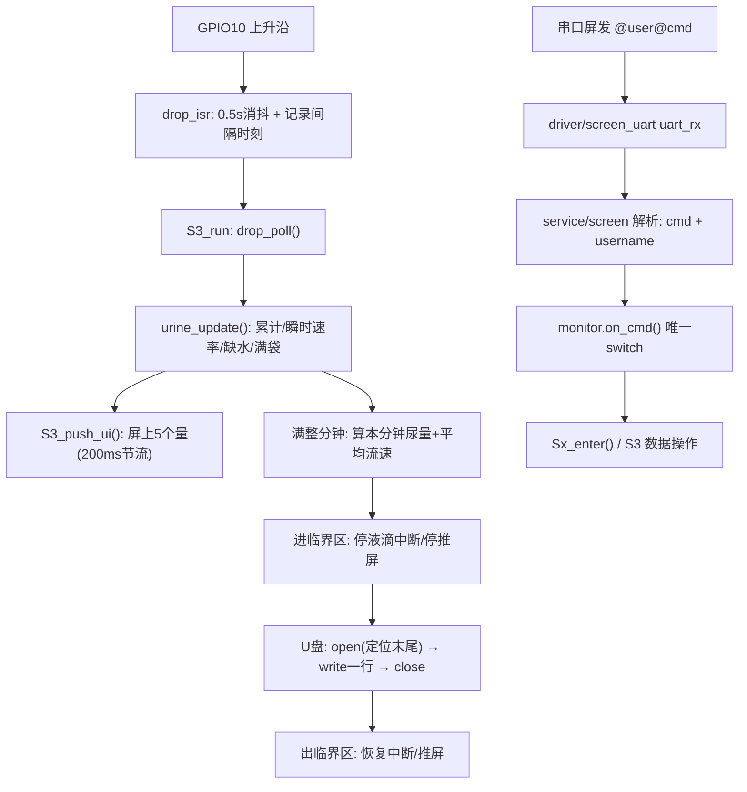

# 尿量计固件 — 工程总览

> ESP32-S3 尿量监测设备固件（分层版）。业务代码全部在 `main/`。
> 板子：ESP32-S3 / ESP-IDF v5.5.5

---

## 1. 设备在做什么

1. 滴传感器数"尿滴"（GPIO10 上升沿，ISR 里 **0.5s 消抖** + 记录相邻间隔）
2. 按 **每滴 0.05 ml**（`URINE_DROP_ML_DEFAULT`，**需标定**）换算累计尿量
3. 把 **5 个量**实时显示到串口屏（淘晶驰 TJC，UART1）
4. 收到串口屏发来的文本命令 → 状态机在 **S1~S4** 之间切换
5. 测量中**每分钟往 U 盘写一行记录**（CH376 + U 盘，追加到 `<用户名>.TXT`）

---

## 2. 分层结构

| 层 | 目录 | 角色 |
|---|---|---|
| 入口 | `main.c` | 初始化与编排（只有初始化 + 空转主循环） |
| app | `app/` | **状态机**：`monitor`（唯一切换点）+ `S1~S4`（各状态要做什么） |
| service | `service/` | 被动服务：`screen`(串口屏) `storage`(U盘) `urine`(解算) |
| driver | `driver/` | 硬件：`ch376` `drop` `screen_uart` `time_svc` `key` `battery` |
| bsp | `bsp/` | 板级：`pin_map.h`(引脚) `err.h`(错误码) |

**依赖方向（禁止反向）**：`main.c → app → service → driver → bsp`

> `service/*` 与 `driver/*` 均为被动层，不建任务、不依赖上层。

---

## 3. 任务划分（FreeRTOS）

| 任务 | 栈 | 优先级 | 周期 | 职责 |
|---|---|---|---|---|
| `monitor` | 4096 | 5 | 20ms | 状态机周期调度：**只有 S3 有活**（采滴 + 解算 + 推屏） |
| `uart_rx` | 4096 | 6 | 阻塞 | `driver/screen_uart` 自建：收屏字节 → `service/screen` 解析 → `monitor.on_cmd()` |

> ⚠️ 命令的**全部处理**（状态转移、U 盘开关文件、SPI）都跑在 `uart_rx` 任务上下文里。
> 所以 `uart_rx` 栈不能给小（曾因 2048 太小出过问题）。

---

## 4. 启动序列（`main.c`）

```c
void app_main(void) {
    /* 启动标识：编译日期时间，用来确认板子上跑的是哪份固件 */
    ESP_LOGI(TAG, "尿量计启动  分层版  build %s %s", __DATE__, __TIME__);

    timesvc_init();          /* driver: 底层取时 */
    drop_init();             /* driver: 液滴中断(GPIO10) */
    screen_uart_init();      /* driver: 串口屏 UART1 */

    if (storage_init() != ERR_OK)          /* service: CH376 主机模式+检测+挂载 */
        ESP_LOGW(TAG, "存储未就绪(可能没插U盘), 仍继续运行");

    screen_init();           /* service: 注册接收回调 + 初始界面 */
    app_monitor_start();     /* app: 状态机(进入 S1) */

    for (;;) vTaskDelay(pdMS_TO_TICKS(1000));   /* 主循环空转 */
}
```

---

## 5. 状态机（S1~S4）

| 状态 | 名称 | 进入时屏幕 |
|---|---|---|
| S1 | 复位待登录 | `t0 = LOGIN` |
| S2 | 已登录未开始 | `t0 = READY` |
| S3 | 测量中 | 强制刷 5 个量 |
| S4 | 暂停 | `t0 = PAUSE` |

### 5.1 命令表（串口屏 → MCU：`@用户名@命令` + 行尾）

| 命令 | S1 | S2 | S3 | S4 |
|---|---|---|---|---|
| `login` | → **S2** | 忽略 | 忽略 | 忽略 |
| `start` | 忽略 | → **S3**（清数据重测） | 忽略 | → **S3**（续测） |
| `stop` | 忽略 | 忽略 | → **S4** | 忽略 |
| `reset` | 复位 | **复位** | **复位** | **复位** |

- **`login`、`reset` 不校验用户名**（login 用来换用户；reset 谁都复位）
- **`start`/`stop` 必须与前一次登录的用户名一致**，否则忽略并告警
- `reset` 在任何状态都能触发 → 关文件 + 清数据 + 回 S1

### 5.2 转移判断只有一处

所有"命令 → 去哪个状态"的判断集中在 **`app/monitor/monitor.c` 的 `on_cmd()` 里那一个 `switch (cmd)`**；
S1~S4 只保留"进入本状态要做什么"（`Sx_enter`）。详见 `app/README.md`。

---

## 6. 数据流



---

## 7. U 盘记录规格

| 项 | 值 |
|---|---|
| 文件名 | `/<大写8.3>.TXT`，由用户名转换（`hoht` → `/HOHT.TXT`） |
| 表头 | 创建文件时写一行 |
| 数据行 | **每分钟一行**：`mm:ss(hh:mm:ss)` + 本分钟尿量 + 本分钟平均流速 |
| 写入时机 | 计时每满一整分钟（第 0 分钟不写） |
| 文件开关 | **不常开**：写那一刻 `open → write → close`，全程在临界区内 |
| 落盘验证 | 建文件后重新挂载(0x31)再回读长度，证明真的写进盘 |

文件内容示例（等宽字体下对齐）：

```
时间(hh:mm:ss)    尿量(ml)            平均流速(ml/h)  
00:01:00          1.6ml               96.0ml/h  
00:02:00         12.3ml              738.0ml/h  
```

详见 `service/storage/README.md`。

---

## 8. 参数速查

| 宏 | 位置 | 默认 | 含义 |
|---|---|---|---|
| `URINE_DROP_ML_DEFAULT` | `service/urine/urine.h` | 0.05f | 每滴 ml（**需标定**） |
| `URINE_BAG_FULL_ML` | 同上 | 2000.0f | 尿袋满阈值 |
| `URINE_DRY_SEC` / `URINE_DRY_CNT` | 同上 | 4 / 100 | 方式A缺水判定 |
| `URINE_RATE_ZERO_MS` | 同上 | **7000** | 距最近一滴超过 7s → 实时速率显示 0 |
| `DROP_DEBOUNCE_US` | `driver/drop/drop.h` | 500000 | 0.5s 消抖 |
| `DROP_WIN_SIZE` | 同上 | 255 | 方式A统计窗口 |
| `S3_UI_PERIOD_MS` | `app/S3/S3.c` | 200 | 推屏节流（约 5Hz） |
| `REC_COL1_W`/`REC_COL2_W`/`REC_GAP`/`REC_TAIL` | `service/storage/storage.h` | 14/12/4空格/2空格 | 记录文件列布局 |
| `RX_TASK_STACK` | `driver/screen_uart/screen_uart.c` | 4096 | uart_rx 任务栈 |

---

## 9. 构建与烧录

### ⚠️ 最常踩的坑：烧错工程

VS Code 里 ESP-IDF 扩展的"当前工程"**曾经指向参考工程 `F:\ESP32\niaio\project`**，
点 IDE 的 Build/Flash 会烧那个工程（它没有串口屏/U盘代码）。

**用工程根目录的 `flash.bat`**：

```bat
cd /d f:\ESP32\niaio\git\second
flash.bat            :: 默认 COM12
flash.bat COM5       :: 指定串口
```

或手动：
```bat
set IDF_PATH=F:\ESP32\v5.5.5\esp-idf
set IDF_TOOLS_PATH=C:\Espressif\tools
set IDF_PYTHON_ENV_PATH=C:\Espressif\tools\python\v5.5.5\venv
set PATH=C:\Espressif\tools\ccache\4.12.1\ccache-4.12.1-windows-x86_64;C:\Espressif\tools\cmake\3.30.2\bin;C:\Espressif\tools\ninja\1.12.1;C:\Espressif\tools\xtensa-esp-elf\esp-14.2.0_20260121\xtensa-esp-elf\bin;%PATH%
cd /d f:\ESP32\niaio\git\second
"%IDF_PYTHON_ENV_PATH%\Scripts\python.exe" "%IDF_PATH%\tools\idf.py" -p COM12 build flash
```

### 其他注意

- `-Werror` 开启：ESP32 上 `uint32_t` 实为 `unsigned long`，打印必须用 `%lu` 并强转 `(unsigned long)`。
- 换目录/换机器后 build 缓存失效 → 删掉 `build/` 重建。
- `export.ps1` 会被 PowerShell 执行策略拦截；`export.bat` 不会把 idf.py 加进 PATH —— 所以直接用 venv 里的 python 跑 `idf.py`。
- IntelliSense 依赖 `build/compile_commands.json`（`.vscode/c_cpp_properties.json` 已配）。

---

## 10. 现状与已知缺口

**已实现**

- 液滴采集（方式A：0.5s 消抖、相邻间隔入环形 `Time[1..255]`）
- 解算：累计尿量 / 瞬时速率（7s 无新滴归零）/ 缺水判定 / 尿袋满
- 串口屏：5 个量显示 + 命令解析（兼容 `\r\n`、`\n`、字面量 `/n`）
- 状态机 S1~S4，`login/start/stop/reset` 全流程可用
- U 盘：按用户名建文件、每分钟追加一行、拔插自动重挂载

**缺口 / 待办**

1. **每滴 0.05 ml 未标定** —— 必须按实际装置标定后才能用于临床读数
2. **中文/超长用户名**：文件名强制转大写 8.3，`张三` → `/__.TXT`，**不同中文名会撞名**；
   如需保原名要走 CH376 的长文件名(LFN)流程
3. **无 RTC**：记录里的时间是**会话计时**（从 `start` 起算），不是绝对时间
4. **`driver/key`（2 路按键）未接入业务**；`driver/battery` 仍是占位 stub
   （目标方案：**ADC 分压 @ GPIO7**，INA228 电量计方案已取消）
5. **`screen.c` 里的 RX 原始字节 dump 是调试用**，正式版可注释掉
6. CH376 驱动里旧的 `CH376T_FILE_CREATE()` / `CH376T_BYTE_WRITE()` / `CH376T_SET_FILE_NAME()`（写死 `/ASD.TXT`、`"hello world"`）已无人调用，可清理
