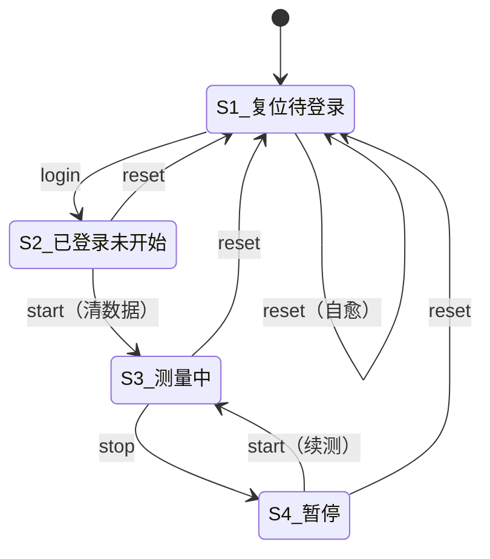
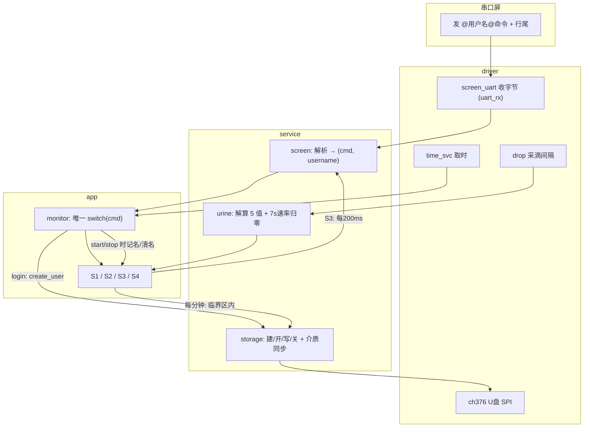

# 测量状态机与指令协议 —— 技术文档

> 工程：`F:\ESP32\niaio\git\second`（分层版）
> 平台：ESP32-S3 / ESP-IDF v5.5.5
> 主题：串口屏（淘晶驰 TJC）通过文本指令驱动"登录-测量-暂停-复位"状态机

---

## 1. 指令协议（串口屏 → 单片机）

```
@用户名@login    登录
@用户名@start    开始测量 / 继续测量
@用户名@stop     暂停测量
@用户名@reset    复位
```

### 1.1 行尾（**现场实测很重要**）

| 写法 | 是否支持 |
|---|---|
| `\r\n`（`0D 0A`） | ✅ 标准 |
| `\n`（`0A`） | ✅ |
| **字面量 `/n`（`2F 6E`）** | ✅ **兼容** |

> ⚠️ 现场屏端发的**不是** `0D 0A`，而是**字符 `/` 和 `n`**（`2F 6E`）——
> HMI 里把 `\r\n` 当转义写了，TJC 不认这种转义，会原样发出去。
> MCU 端三种都认，但**屏端建议改对**：
> ```
> prints "@abc@login",0
> printh 0D 0A
> ```

### 1.2 用户名规则

- 夹在**两个 `@` 之间**，取第 1 个 `@` 与第 2 个 `@` 之间的**全部字符**
- **可以含空格**（含首尾空格），**不含 `@`** → 用两个 `@` 定界唯一
- 原样保留、**不做 trim**
- 最长 **31** 字符（`SCREEN_USERNAME_MAX`）

### 1.3 用户名校验规则

| 命令 | 是否校验用户名 |
|---|---|
| `login` | ❌ 不校验（它就是用来换用户的） |
| `reset` | ❌ 不校验（**不管当前登录的是谁，收到就复位**） |
| `start` | ✅ 必须与当前登录用户名一致 |
| `stop` | ✅ 必须与当前登录用户名一致 |

### 1.4 行首杂字节

屏在**上电/复位时**会回传一帧 `1A FF FF FF`（既不是行尾也不是 `/n`）。
若不处理，它会赖在行缓冲里把**第一帧命令**顶成"非 `@` 开头"而整帧丢弃。

**两道防护**（`service/screen`）：
1. 行缓冲为空时只接受 `@`，其它字节直接丢
2. 解析时从行内**第一个 `@`** 开始（并打 WARN 提示跳过了几个字节）

---

## 2. 指令对应表

| 完整指令 | 指令 | 含义 | 状态变化 |
|---|---|---|---|
| `@用户@login` | login | 登录（建文件） | S1 → S2 |
| `@用户@start` | start | 开始测量 | S2 → S3 |
| `@用户@start` | start | 继续测量 | S4 → S3 |
| `@用户@stop` | stop | 暂停 | S3 → S4 |
| `@用户@reset` | reset | 复位 | **任意状态 → S1** |

---

## 3. 四个状态

| 状态 | 名称 | 含义 | 屏上状态文本 |
|---|---|---|---|
| S1 | 复位待登录 | 上电/复位后；未登录 | `LOGIN` |
| S2 | 已登录未开始 | 已登录、文件已创建；未测量 | `READY` |
| S3 | 测量中 | 采滴、解算 5 值、上屏、每分钟写 U 盘 | （强弱见 §5） |
| S4 | 暂停 | 停止计时；数据保留 | `PAUSE` |

---

## 4. 状态转移图



> **`reset` 在 S2/S3/S4 都能触发**（早期版本只允许 S4，已放宽）。
> `start` 在 S1/S3 忽略并告警；`stop` 只在 S3 有效；`login` 只在 S1 有效。

---

## 5. 关键变量随事件的变化

| 变量 | login(→S2) | start(→S3) | stop(→S4) | 暂停后 start(→S3) | reset(→S1) |
|---|---|---|---|---|---|
| `s_state` | S2 | S3 | S4 | S3 | S1 |
| `s_user[]` | 写入 | 不变 | 不变 | 不变 | **清空** |
| U盘文件 | **创建+表头**（建完即关） | 记名（写时才开） | 不变 | 记名 | **关闭+清名** |
| `s_meas` | 待命(0) | **清零, 从0计** | 冻结 | 保持/继续 | **清零** |
| `s_elapsed_ms` | 0 | 从 0 走 | **冻结** | 继续走 | **归 0** |
| `s_last_ml` / `s_last_min` | 0 | 0 | 保持 | 保持 | **归 0** |
| 采滴/推屏 | 停 | **开**（每 200ms 推一次） | 停（数值冻结在屏上） | **开** | 停 |
| 屏上数值 | 不变 | 5 个量刷新 | 冻结 | 恢复刷新 | **4 个数值归零** |
| 屏上状态文本 | `READY` | `READY`/`DRY`/`BAG FULL` | `PAUSE` | 回 `READY`… | `LOGIN` |

---

## 6. 系统框图



---

## 7. 层间职责归属

| 职责 | 放哪层 | 现状 |
|---|---|---|
| **命令 → 状态** 的判断 | **app/monitor** | ✅ `on_cmd()` 里唯一一个 `switch` |
| 各状态"进入时做什么" | **app/S1~S4** | ✅ 各自 `Sx_enter()`；S3 另有测量接口 |
| 命令协议解析（`@..@cmd` + 行尾） | **service/screen** | ✅ 含 `/n` 兼容、行首杂字节丢弃 |
| 5 值采集/解算 | **service/urine** + **driver/drop** | ✅ 测量态才喂 |
| 串口屏显示 5 值 | **service/screen** | ✅ `screen_show_*` |
| U盘建/开/写/关 + 介质拔插识别 | **service/storage** + **driver/ch376** | ✅ |
| 每分钟写盘 + 临界区 | **app/S3** | ✅ |

---

## 8. U 盘记录规格

### 8.1 文件名

**必须是大写 8.3**（CH376 的 `SET_FILE_NAME` 限制）：

| 用户名 | 文件名 |
|---|---|
| `abc` | `/ABC.TXT` |
| `hoht` | `/HOHT.TXT` |
| `张三` | `/__.TXT` ⚠️ 中文压成 `_`，不同中文名会**撞名** |

转换规则：`a-z→A-Z`；字母数字 `_` `-` 保留；空格/中文/其它 → `_`；截断到 8 字符。

### 8.2 文件内容

```
时间(hh:mm:ss)    尿量(ml)            平均流速(ml/h)  
00:01:00          1.6ml               96.0ml/h  
00:02:00         12.3ml              738.0ml/h  
00:03:00          0.0ml                0.0ml/h  
```

- 表头：**只在新建文件时写**（已存在的文件不会被覆盖、也不会重复写表头）
- 数据行：**每分钟一行**
  - **本分钟尿量** = 本分钟末累计总量 − 上一分钟标记时的累计总量
  - **本分钟平均流速** = 本分钟尿量 × 60（ml/h）
  - 整分钟一滴都没有 → 照写 `0.0ml 0.0ml/h`
  - 第 0 分钟（start 瞬间）**不写**
- 列宽/间隔宏在 `service/storage/storage.h`（表头与数据行共用）
- 同一用户重复登录 → **追加**到原文件末尾

### 8.3 写入方式：**文件不常开**

```
start   → 只记住用户名 + 做一次介质检查
每分钟  → 进临界区：
              停液滴中断 + 暂停推屏 + 屏蔽 CH376 日志 + 拿 SPI 锁
              open(定位到文件末尾) → write 一行 → close   ← 全程只做 SPI，无任何日志
          出临界区：恢复中断/推屏/日志，打一条 "已写入U盘"
```

**好处**：文件同时处于打开状态只有几十毫秒，拔盘/断电最多丢当前这一分钟
（早期"start 打开、stop 关闭"的版本会丢掉整个文件）。

---

## 9. 速率（屏上 `data.n1`）

| 情况 | 显示 |
|---|---|
| 正常滴落 | `3600 × 每滴ml ÷ 间隔秒` |
| 距最近一滴 ≤ 7s | 保持最后一次算出的值 |
| **距最近一滴 > 7s** | **0.0** |

参数：`urine.h` 的 `URINE_RATE_ZERO_MS = 7000`。

> 只影响**屏上实时速率**。U 盘里那条"本分钟平均流速"不受影响（那是这一分钟的平均）。

---

## 10. 目标板/接线速查

| 外设 | 引脚 |
|---|---|
| 串口屏 UART1 | TX=GPIO17（MCU→屏 RX）、RX=GPIO18（屏 TX→MCU），115200 |
| 液滴检测 | GPIO10（上升沿，0.5s 消抖） |
| CH376 软 SPI | SCS=GPIO2、MOSI=GPIO41、MISO=GPIO40、SCK=GPIO42、INT=GPIO1 |
| 日志口 | UART0（USB 串口，115200） |

---

## 11. 待补充 / 已知限制

1. **无 RTC**：记录里的时间是**会话计时**（从 `start` 起算），不是绝对时间
2. **中文/超长用户名**会撞名（见 §8.1）；要保原名需实现 CH376 的 LFN
3. **每滴 0.05 ml 需标定**
4. 拔盘前建议先 `stop`/`reset`；插回后 `login`/`start` 会自动重新挂载
5. 掉电时正在写的那一行可能不完整（critical section 内没有事务保护）
