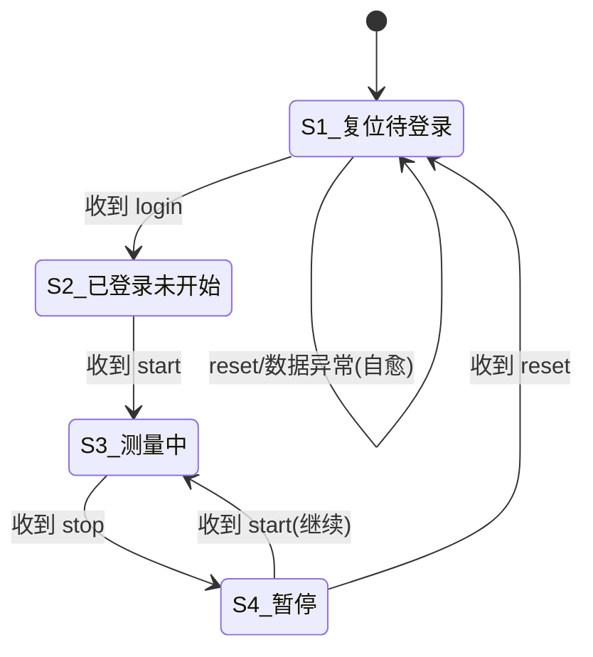
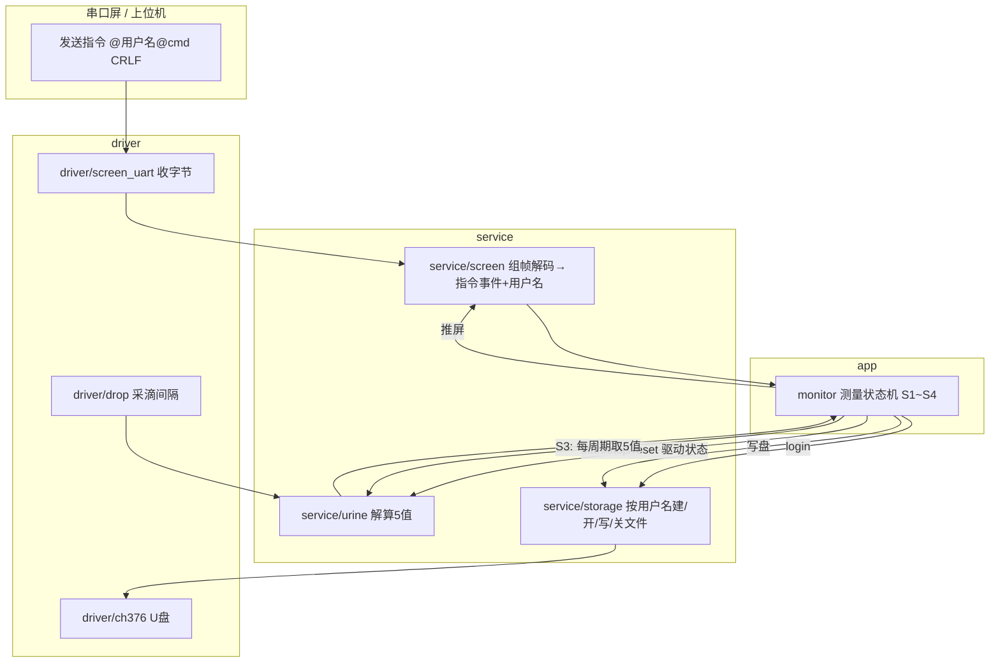

# 测量状态机与指令协议 —— 技术文档

> 工程：`F:\ESP32\niaio\git\second`（分层版）
> 平台：ESP32-S3 / ESP-IDF
> 主题：串口屏/上位机通过文本指令驱动"登录-测量-暂停-复位"状态机

---

## 1. 指令协议（串口屏 → 单片机，逐条以 `\r\n` 结尾）

```
@用户名@login \r\n   登录
@用户名@start \r\n   开始测量 / 继续测量
@用户名@stop  \r\n   暂停测量
@用户名@reset \r\n   复位(仅暂停态触发)
```

- `用户名` 为字符串；`login/start/stop/reset` 为指令关键字。
- 除 `login` 外，其余指令里的用户名须与**当前已登录用户名**一致才生效。

---

## 2. 四个状态

| 状态 | 名称 | 含义 |
|---|---|---|
| S1 | 复位待登录 | 上电/复位后；未登录、未开文件 |
| S2 | 已登录未开始 | 已登录、U盘文件已创建并打开；未测量 |
| S3 | 测量中 | 采滴、解算 5 值、上屏、写U盘 |
| S4 | 暂停 | 停止采集/计时；可继续或复位 |

---

## 3. 状态转移图



---

## 4. 重要变量

核心变量：
1. `state`（S1~S4）
2. `username[]`（当前登录用户名）
3. U盘文件：`file_open` + 文件名（登录时创建并打开；复位时关闭）
4. 测量累计 `urine_meas_t meas` + 起点 `base`
5. 会话计时 `elapsed_ms`
6. 分钟记录缓存 `record[]`
7. 命令解析缓冲/校验结果

### 关键变量随事件的变化表

| 变量 | 收到 login(→S2) | 收到 start(→S3) | 收到 stop(→S4) | 暂停后 start(→S3) | 收到 reset(→S1) |
|---|---|---|---|---|---|
| `state` | S2 | S3 | S4 | S3 | S1 |
| `username[]` | 写入并校验 | 不变 | 不变 | 不变 | **清空** |
| U盘文件 | **创建+打开**(名=用户名) | 保持打开 | 保持打开 | 保持打开 | **关闭** |
| `meas`/`base` | 待命(0) | **重置基准,从0计** | 冻结(不改) | 保持/继续 | **清零** |
| `elapsed_ms`(计时) | 0 | 从0走 | **冻结** | 继续走 | **归0** |
| `record[]`(分钟缓存) | 清空 | 每新分钟push | 停止push | 继续push | **清空** |
| 采滴/喂尿量 | 停 | **开** | 停 | **开** | 停 |
| 串口屏/写盘 | 只显示待命 | 实时5值+写盘 | 停止 | 恢复5值+写盘 | 清屏/待登录 |

---

## 5. 系统框图（分层 + 指令流向）



---

## 6. 层间职责归属

| 职责 | 放哪层 | 说明 |
|---|---|---|
| 状态机 `S1~S4` | **app/monitor** | 唯一中枢，消费指令事件 |
| 命令协议解析（`@..@cmd\r\n`→事件+用户名） | **service/screen**（接收解码处） | 改造 `handle_rx_frame` 解析这 4 条文本指令 |
| 按用户名建/开/写/关 U盘文件 | **service/storage**（扩展） | `storage_open_by_user(name)`、写、`storage_close()` |
| 5 值采集/解算 | **service/urine** + **driver/drop** | 现有，测量态才喂 |
| 串口屏显示 5 值 | **service/screen** | 现有 `screen_show_*` |

---

## 7. 待补充（U盘写盘细节 / 用户名边界）

1. **S3 测量态 → U盘"怎么写"**：每 N 秒写一行？按分钟写？还是缓存后批量写？（待详细设计）
2. 用户名长度上限、文件名是否加后缀（如 `.txt`）、断电/异常时文件如何收尾。
3. reset 时是否先把本次记录落盘再清零，还是直接清零+关文件（当前按"清零+关文件"）。
